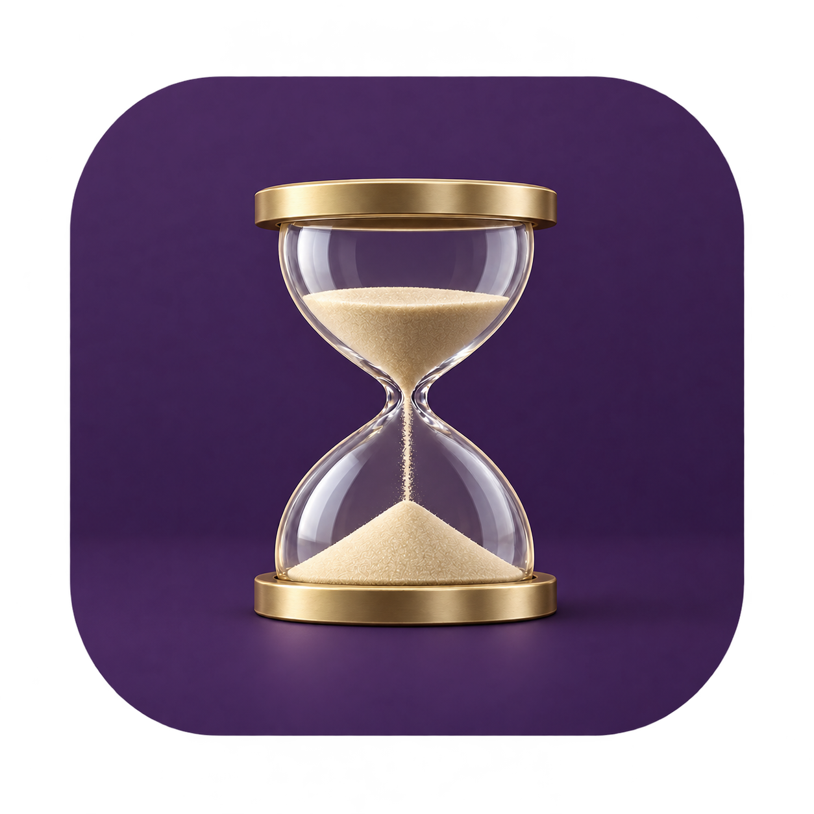
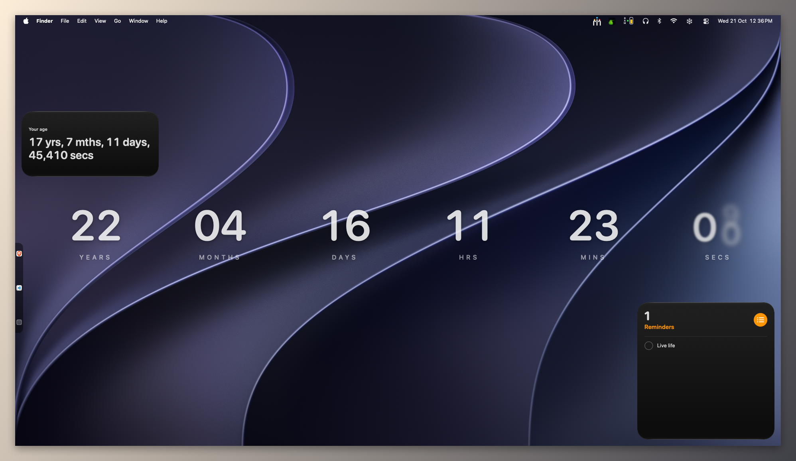
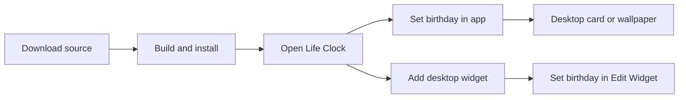

<p align="center">
  
</p>

# Life Clock

**Watch your life move, right on your Mac.**

Life Clock shows your age as a live desktop card, a wallpaper clock or a macOS widget. You can also count down to a personal target age and see a short greeting on your birthday.

Built with Swift, SwiftUI and WidgetKit. No third-party packages, account or paid Apple developer membership needed.

<p align="center">
  
</p>

[Get started](#get-started) · [Use the app](#use-the-app) · [Add a widget](#add-a-widget) · [Troubleshooting](#troubleshooting) · [For-developers](#for-developers)

## Three ways to keep time

| View | Best for |
| --- | --- |
| **Desktop card** | A movable, resizable clock with age formats and optional subsecond columns. |
| **Wallpaper mode** | A large clock behind your windows and desktop icons, with display and layout controls. |
| **Desktop widget** | A small or medium macOS widget with its own birthday and clock settings. |



> The app and widgets have separate settings. If you use both, enter your birthday in both places. Each widget can show a different person or clock.

## Get started

### 1. Check what you need

- **macOS 14 or later** to run the app. Live widget calendar updates need **macOS 15 or later**.
- **Xcode 26 or later** to build this source, including its macOS 26 glass APIs. Your build Mac must support that version of Xcode.
- The full Xcode app; Command Line Tools alone are not enough. Open Xcode once and finish its first-launch setup. In **Xcode → Settings → Locations**, select Xcode under **Command Line Tools**.

These instructions build the app on your Mac. The repository does not include a ready-to-install, notarised app or automatic updater.

### 2. Download the source

On the [GitHub repository](https://github.com/BlueKeys-dev/LIFE_CLOCK_MAC_WIDGET), choose **Code → Download ZIP**, then unzip it.

Or use Terminal:

```sh
git clone https://github.com/BlueKeys-dev/LIFE_CLOCK_MAC_WIDGET.git
cd LIFE_CLOCK_MAC_WIDGET
```

If you downloaded the ZIP, open Terminal, type `cd `, drag the extracted folder into Terminal, and press Return.

### 3. Build and install

Run this from the project folder:

```sh
./build.sh
```

The script runs focused tests, builds the app, checks its signatures, backs up any existing installation, installs to `/Applications/LifeClock.app`, registers the widget and opens Life Clock.

**Save any settings edits first:** the script closes a running copy during installation. A failed build or test leaves the installed app untouched; an installation failure attempts to restore the previous copy. Logs and backups are saved in `.build/logs/`.

If you cannot write to `/Applications`, install just for your user:

```sh
mkdir -p "$HOME/Applications"
LIFECLOCK_INSTALL_DIR="$HOME/Applications" ./build.sh
```

Keep the app in that location, especially if you enable launch at login. Avoid keeping installed copies in both Applications folders.

<details>
<summary>Prefer to run from Xcode?</summary>

Open `LifeClock.xcodeproj`, select the **LifeClock** scheme and **My Mac**, then click **Run**. The project uses **Sign to Run Locally** (ad-hoc signing), without a development team or App Group.

This is useful for development. For everyday use and launch at login, use the install script above so the app has a stable home.

</details>

## Use the app

1. Open Life Clock and enter your birthday. Birth time is optional; without it, the app uses midnight and marks the age approximate.
2. Choose your birth timezone, or use **Use Mac timezone**, then select **Set birthday** for the first setup.
3. Choose your desktop-card format in Settings. Drag the card to move it and use its lower-right grip to resize it.

| Clock | What you see |
| --- | --- |
| **Live age card** | Years, months, days, hours, minutes and seconds. |
| **Detailed age** | Your calendar age with additional time detail. |
| **Decimal years** | Your age as a number with a fractional year. |
| **Total seconds** | Time since your birth, expressed in seconds. |
| **Years remaining** | A countdown to your chosen target age, stopping at zero. |

The target age defaults to **80** and accepts **1–150**. It is a personal goal, not a prediction of lifespan.

Use **Wallpaper mode** for a large clock behind desktop icons. Choose a display and adjust its position, size and appearance. Clicks pass through the wallpaper clock; open Settings from the menu-bar hourglass. If you hide the menu-bar icon, reopen the app from Applications to reach Settings.

Enable launch at login if you want the clock and birthday greetings after restarting. macOS may ask for approval in **System Settings → General → Login Items**.

## Add a widget

1. Launch the installed app once.
2. Right-click the desktop → **Edit Widgets** → search for **Life Clock**.
3. Add the small or medium widget.
4. Right-click it → **Edit Widget**. Set your birth day, month, year and timezone. Optional birth time uses `HH:mm`, for example `14:30`.
5. Choose **Age** or **Years remaining**, then select the time units you want.

Years always appear. New widgets enable months and days; hours, minutes and seconds start off. Enable **Seconds** for a ticking display on supported macOS versions. Zero-valued units may disappear.

**Adding the widget is manual.** The install script registers it with macOS but cannot place it on your desktop.

See the [widget quick setup](Widget/SETUP.md) for a short guide.

## Privacy and date rules

- Birthday settings stay on your Mac. The app uses local preferences; macOS stores each widget's configuration separately. These are not encrypted secret storage.
- City searches use local timezone names unless you choose **Search online with Apple**, which sends the typed city query to Apple's geocoding service.
- Birthday greetings follow your Mac's current local date. Age calculations use your saved birth timezone.
- February 29 birthdays use February 28 in non-leap years.
- Future birthdays and invalid dates are rejected. A birth time skipped by daylight saving is rejected; repeated hours use the system's default occurrence.
- The app must be running for birthday greetings. It shows one greeting per birthday date and does not show a missed greeting the following day.

## Troubleshooting

| Problem | What to try |
| --- | --- |
| Build reports a missing SDK or unknown glass API | Use full Xcode 26 or later and select it under Xcode's Command Line Tools setting. |
| Installation cannot write to Applications | Use the user-only install command above. |
| Widget is missing or shows old settings | Launch the installed app, then remove and re-add the widget through Edit Widgets. |
| Changing the app's birthday does not change the widget | Set the widget's birthday separately through Edit Widget. |
| Widget does not tick | Enable Seconds. On macOS 14, updates are system-scheduled snapshots; even on newer versions, macOS controls widget updates. |
| Wallpaper digits are hard to read | Adjust the glass options or system light/dark appearance. Text follows system appearance, not the wallpaper image. |
| Birthday greeting did not appear | Keep the app running and check the Mac's local date. A greeting already shown today will not repeat. |

Very small time units are display estimates, not measurement precision. Display refresh and the system clock limit their accuracy. Desktop visibility can also vary with Spaces, Show Desktop and Stage Manager.

## For developers

```text
App/          Menu-bar app, settings, desktop card and birthday greeting
Widget/       WidgetKit extension and widget setup guide
Shared/       Age calculations, app preferences and window-placement rules
Tests/        Focused calculation, birthday and placement tests
Tools/        App icon generation
build.sh      Test, build, back up, install and launch locally
```

After app or widget changes, run `./build.sh`. To build or test without installing:

```sh
xcodebuild -project LifeClock.xcodeproj -scheme LifeClock -destination 'platform=macOS' build
xcodebuild -project LifeClock.xcodeproj -scheme LifeClock -destination 'platform=macOS' -only-testing:LifeClockTests test
```

Tests cover calculation and policy rules; they do not prove macOS widget placement, login approval or window behaviour. Check those on a real Mac: configure two widgets independently, sleep and wake, reconnect a display, and try light/dark appearance and Reduce Motion.

When reporting a problem, include your macOS version, Xcode version and the steps to reproduce it. Remove personal birthday details and private paths from screenshots and logs before sharing them.
